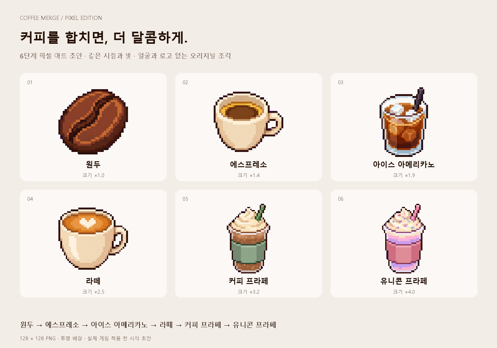
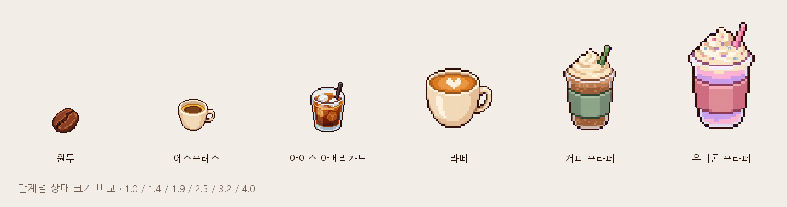

# 커피내기 머지 — 픽셀 카페 디자인 기준

버전: 1.2 · 2026-11-14 · 팀 공유용

## 1. 확정한 방향과 이 문서의 용도

**따뜻한 픽셀 카페에서 커피를 합치는 게임**으로 디자인해요. 크림색 도자기, 호박빛 커피, 갈색 도트 외곽선, 세이지와 로즈 포인트를 모든 화면과 게임 자산에 연결해요.

2026-11-14 사용자가 음료 6단계 픽셀 시안을 확인하고 “이 느낌 좋아. 이대로 제작하자”라고 방향을 확정했어요. 이전 벡터 조각은 이번 제작의 원본으로 사용하지 않아요.

이 문서는 다른 디자이너·개발자·AI 도구가 같은 방향으로 이어서 만드는 기준이에요. 화면 전체의 완성 시안이나 게임 규칙을 대체하지 않아요.

| 구분 | 현재 상태 |
|---|---|
| 승인된 시각 원본 | 아래의 픽셀 커피 조각 6개와 그 시점·빛·질감·색 관계 |
| 확정된 적용 범위 | 홈, 방 설정·입장, 대기실, 플레이, 결과와 공통 UI에 같은 콘셉트 적용 |
| 이번 문서에서 정리한 것 | 원본을 확장할 화면별 구성, UI 표현, 에셋 규격과 구현 기준 |
| 후속 제작 대상 | 전체 화면 시안, 게임판·장식·상태 아이콘, 확정 후 제작할 방해물, 실제 게임 적용 |
| 별도 확인 대상 | 실제 폰에서 작은 조각 식별성, 가독성, 물리 충돌과 그림의 정렬, 게임 성능 |

### 원본을 찾는 순서

1. [승인된 픽셀 Figma 시안](https://www.figma.com/design/u8lS8N31f0IdLLsnqCdzZq/5%EC%A1%B0-%ED%94%BC%EA%B7%B8%EB%A7%88-%EC%98%A4%EC%9D%B4%EC%8B%9C?node-id=9-17): `Page 1`의 `03 커피내기 머지 · 픽셀 아트 6단계` 섹션이에요. `04 픽셀 아트 원본 · 투명 PNG 컴포넌트`에 개별 컴포넌트가 있어요. 최신 공유 위치이며 제목·단계명·배치는 수정할 수 있어요.
2. 이 저장소의 [승인 에셋 목록](design-assets/approved-assets.json)과 아래 이미지가 다른 PC에서도 열리는 기준 사본이에요.
3. [PRD.md](PRD.md)는 서비스 흐름과 룰, [constants.js](../src/game/constants.js)는 현재 단계 이름·수치, [index.css](../src/index.css)는 UI 토큰, [strings.js](../src/strings.js)는 화면 문구의 원본이에요.
4. 구현 방식과 수정 범위는 [AGENTS.md](../AGENTS.md)를 따라요. 현재 프로젝트는 React + Vite + Tailwind CSS v4 + shadcn/ui예요.



## 2. 디자인의 다섯 가지 원칙

| 원칙 | 화면에서 보여야 할 것 |
|---|---|
| 따뜻한 카페 | 우유색 바탕, 원두색 글자, 도자기와 커피의 온기. 조용히 잠깐 즐기는 분위기 |
| 또렷한 도트 | 계단형 외곽, 네모난 픽셀 덩어리, 제한된 명암. 부드럽게 번지는 보간 없이 표시 |
| 마시고 싶은 커피 | 크레마·얼음·라테 아트·휘핑·음료층처럼 종류를 설명하는 재료 |
| 바로 읽히는 대결 | 내 점수·시간·다음 조각·공격·커피 담당이 장식보다 먼저 보임 |
| 같은 게임으로 보이는 일관성 | 조각·장애물·장식의 도트 크기와 빛 방향, 화면의 색·글꼴·버튼 체계를 통일 |

참고 이미지에서 가져오는 것은 색과 도트 표현 방식이에요. 토끼 캐릭터, 브랜드·로고·글자, 샌드위치, 기존 게임의 화면 배치는 넣지 않아요. 조각에는 얼굴을 추가하지 않아요. 새 자산의 특징은 재료와 실루엣으로 만들어요.

## 3. 픽셀 아트 제작 규칙

### 시점·빛·형태

- 정면에 가까운 같은 시점을 써요. 컵 입구가 얕은 타원으로 보이는 정도만 위에서 내려다봐요.
- 빛은 왼쪽 위, 그림자는 오른쪽 아래예요. 하이라이트도 작은 픽셀 덩어리로 만들어요.
- 외곽은 검정에 가까운 원두색, 내부는 따뜻한 중간색과 밝은 크림색으로 정리해요. 진한 면·중간 면·하이라이트가 작은 크기에서도 남아야 해요.
- 둥근 사물도 경계는 계단처럼 표현해요. 매끈한 벡터 외곽선, 사진 질감, 광택이 강한 3D로 바꾸지 않아요.
- 잔·휘핑·빨대가 칸 밖으로 잘리지 않게 해요. 손잡이는 짧게, 빨대는 길게 튀어나오지 않게 잡아요.
- 바닥 그림자·접시·탁자·소품을 음료 PNG에 합치지 않아요. 그림자가 필요하면 화면에서 별도 레이어로 처리해요.

### 색의 역할

- 원두·에스프레소·아메리카노는 볶은 갈색과 호박색으로 이어져요.
- 에스프레소와 라떼는 크림색 도자기를 공유하되, 커피 표면과 하트로 구분해요.
- 커피 프라페는 세이지색 띠·빨대, 유니콘 프라페는 로즈색 띠·층·스프링클이 특징이에요.
- 분홍과 초록은 특정 단계의 구분 신호예요. 모든 화면과 모든 조각에 같은 양으로 뿌리지 않아요.
- PNG 내부는 승인된 그림의 명암 팔레트를 유지해요. UI 토큰 색 하나로 그림 전체를 덮거나 CSS 필터로 재색칠하지 않아요.

### 새 에셋을 생성할 때 공유할 스타일 문장

다음 문장은 도구와 상관없이 새 커피·장애물·소품의 공통 기준으로 사용해요. 에셋 설명은 문장 바깥에 붙이고, 시점·빛·외곽선 규칙은 유지해요.

```text
Cozy handcrafted pixel art with crisp square pixel clusters, stepped silhouettes, restrained dithering, and dark coffee-brown edge pixels. Use warm cream ceramic, amber coffee, milky highlights, and muted green or rose accents for distinct drink tiers. Gentle upper-left lighting creates tactile depth without glossy realism. Maintain a consistent flat frontal view with a shallow visible cup opening, compact rounded proportions, clear silhouette separation, and readable details at small game sizes. Avoid smooth vector curves, anti-aliasing, text, logos, and character faces.
```

기존 조각을 참조 이미지로 함께 넣어 일관성을 맞춰요. 글자와 숫자는 그림에 생성하지 않고 UI에서 넣어요. 투명 배경은 PNG의 실제 알파 채널로 확인해요. 배경 제거용 색이나 가짜 체크무늬가 남은 이미지는 사용하지 않아요.

## 4. 음료 6단계와 원본 파일

아래 이름과 배수는 현재 `DRINKS`의 문서 작성 시점 값이에요. 이후 수치 변경은 `src/game/constants.js`에서 관리하고 문서를 동기화해요. 이 표를 별도 게임 설정으로 복사하지 않아요.

| 단계 | 이름 | 반드시 남길 시각 특징 | 에셋 | UI 구분 토큰 | 상대 크기 |
|---|---|---|---|---|---|
| 1 | 원두 | 타원형 볶은 콩, 휜 가운데 홈, 따뜻한 윤기 | [bean.png](design-assets/drinks/bean.png) | `bean` | 1.0 |
| 2 | 에스프레소 | 작은 크림 잔, 둥근 손잡이, 진한 커피와 크레마 | [espresso.png](design-assets/drinks/espresso.png) | `espresso` | 1.4 |
| 3 | 아이스 아메리카노 | 투명한 잔, 호박빛 커피, 네모난 얼음, 짧은 빨대 | [americano.png](design-assets/drinks/americano.png) | `americano` | 1.9 |
| 4 | 라떼 | 넓은 크림색 머그, 밝은 표면, 흰 하트 라테 아트 | [latte.png](design-assets/drinks/latte.png) | `latte` | 2.5 |
| 5 | 커피 프라페 | 짧고 통통한 테이크아웃 컵, 커피층, 휘핑, 세이지 띠 | [frappe.png](design-assets/drinks/frappe.png) | `frappe` | 3.2 |
| 6 | 유니콘 프라페 | 같은 계열 컵, 분홍·라벤더·크림층, 휘핑과 스프링클 | [unicorn.png](design-assets/drinks/unicorn.png) | `unicorn` | 4.0 |

PRD에 남은 “프라푸치노” 표기 대신 현재 코드의 “커피 프라페 / 유니콘 프라페”를 써요. 생두·분쇄 원두·커피 포트·로스터기를 새 단계로 끼워 넣지 않아요.



### 파일과 표시 규격

- 배포용 사본은 **128×128, RGBA PNG, 투명 배경, 한 파일에 한 조각**이에요. 파일 이름과 단계 연결은 [approved-assets.json](design-assets/approved-assets.json)에 있어요.
- 비교판은 모양을 읽기 위해 같은 크기로 놓았어요. 게임에서는 위 배수를 적용해요. 비교판의 간격·글자·카드 배경은 스프라이트에 포함하지 않아요.
- 원본 캔버스 안의 그림은 긴 변 약 112px 범위에 가운데 정렬돼 있어요. 남은 투명 여백을 포함한 128px 전체를 그림의 물리적 지름으로 착각하지 않아요. 정확한 알파 경계는 목록 파일의 `contentBounds`를 확인해요.
- CSS 이미지에는 Tailwind의 `[image-rendering:pixelated]`를 사용해요. 그림 크기를 늘릴 때는 가능하면 2배·3배 같은 정수 배율을 써요.
- Canvas에서는 `ctx.imageSmoothingEnabled = false`로 그려요. 새 PNG를 내보낼 때도 최근접 이웃(Nearest Neighbor) 방식으로 크기를 조절해요.
- Canvas의 기기 픽셀 비율 처리를 하더라도 물리 좌표는 CSS 픽셀 단위를 유지해요. 도트를 맞춘다는 이유로 물리 위치·반지름·충돌 계산을 반올림하지 않아요.
- 실루엣을 가로·세로로 따로 늘리지 않아요. 알파 경계와 물리 원의 중심을 맞추고, 긴 변과 지름의 비율을 조정해요. 손잡이·빨대가 원 밖에 보이는 근사치는 실제 플레이에서 확인해요. PNG의 사각형을 그대로 충돌체로 쓰지 않아요.

현재 `BASE_RADIUS = 16` 기준 충돌 지름은 `2 × BASE_RADIUS × size`예요. 그림을 넣는 작업으로 기본 반지름이나 상대 배수를 바꾸지 않아요.

## 5. 화면 전체의 색·글자·여백

### 색상

UI는 `src/index.css`의 토큰을 사용해요. 아래 HEX는 현재 라이트 모드 OKLCH 값을 sRGB로 옮긴 참고값이며, 구현에 HEX를 직접 넣는 근거가 아니에요.

| 역할 | Tailwind / 토큰 | 라이트 모드 참고색 | 적용 |
|---|---|---|---|
| 전체 바탕 | `bg-background` | `#FBF8F5` | 넓은 밝은 우유색 면 |
| 기본 글자 | `text-foreground` | `#241005` | 제목, 점수, 주요 정보 |
| 패널·카드 | `bg-card` | `#FFFFFF` | 입력·목록·결과의 읽기 쉬운 면 |
| 주요 행동 | `bg-primary`, `text-primary-foreground` | `#7F4413` | 방 만들기, 시작 등 주 행동 |
| 보조 카페 면 | `bg-secondary` | `#F1E6DA` | 주문표 느낌의 보조 패널 |
| 약한 구분 면 | `bg-muted` | `#F3EDE7` | 대기·보조 정보 |
| 보조 글자 | `text-muted-foreground` | `#725F54` | 설명, 단위, 상태 안내 |
| 경계 | `border-border` | `#E5DCD4` | 입력 경계와 구분선 |
| 오류·위험 | `text-destructive`, `border-destructive` | 실제 토큰 참조 | 잘못된 코드, 넘침 위험 |

음료색은 `bg-bean`, `bg-espresso`, `bg-americano`, `bg-latte`, `bg-frappe`, `bg-unicorn`으로 접근해요. 참가자 색은 단계 의미와 섞이지 않게 기존 차트 토큰과 닉네임을 함께 써요. 색만으로 내 플레이어·탈락·공격을 구분하지 않아요.

새 역할 색이나 도트 프레임용 토큰이 필요하면 `src/index.css`의 담당자와 공유해 정의해요. 컴포넌트 안에 임의 색 클래스를 넣지 않아요.

### 라이트·다크 모드와 메인 화면

[라이트 메인 시안](https://www.figma.com/design/u8lS8N31f0IdLLsnqCdzZq?node-id=64-3400)의 낮 배경과 [다크 메인 시안](https://www.figma.com/design/u8lS8N31f0IdLLsnqCdzZq?node-id=44-3525)의 밤 배경·로고·START 버튼을 `public/assets/home/`에서 사용해요. 두 배경은 같은 1080×2340 원본 크기로 카페 외관과 로고·버튼 배치를 맞춰요. 라이트의 넓은 화면 바깥 면은 낮 하늘에서 가져온 `--home-backdrop: #5DB6E8`, 다크는 `#1B1934`를 사용해요.

완성 화면 한 장을 UI로 붙이지 않고, START는 실제 버튼으로 만들어요. 누르면 닉네임·방 만들기·코드 입장 화면이 열리고, 기존 화면 콜백으로 이어져요. 입력 화면과 게임의 라이트 토큰은 위의 기존 값을 사용해요.

다크 모드의 색은 해당 시안 에셋에서 읽은 값이며 `src/index.css`의 `.dark`에 연결돼요.

| 역할 | 토큰 | 다크 HEX |
|---|---|---|
| 밤하늘 바탕 | `--background` | `#1B1934` |
| 카드·팝오버 | `--card`, `--popover` | `#24204A` |
| 보조 면 | `--secondary`, `--muted` | `#33285C` |
| 기본 글자 | `--foreground` | `#FFFCD6` |
| 주요 행동 | `--primary` | `#F45F88` |
| 주요 행동 글자 | `--primary-foreground` | `#1B1934` |
| 보조 글자 | `--muted-foreground` | `#CFC7FF` |
| 강조 면 | `--accent` | `#4B3166` |
| 포커스 | `--ring` | `#FFDF96` |

홈의 `라이트 / 다크 / 자동`에서 선택하고 브라우저에 저장해요. 처음에는 기기 설정을 따르며, 자동 선택 중에는 기기 설정 변경도 반영해요. 저장소가 차단돼도 현재 탭에서 전환할 수 있어요. 첫 렌더 전에 모드를 적용하고 다른 탭의 선택 변경도 동기화해요.

음료 PNG의 색은 유지해요. 플레이 화면은 다크 모드에서 기존 카페 배경의 불투명도를 `--cafe-background-opacity`로 낮추고, 게임판 내부는 `--background`를 사용해요. 플레이 중 모드가 바뀌면 캔버스의 안내선·대체 도형 색도 다시 읽으며 게임 진행 상태는 유지해요.

### 글자

- 제품 글꼴은 기존 `Geist Variable`과 `font-sans`를 사용해요. Figma의 한글 표시는 `Noto Sans KR`을 보조로 사용했어요. 이 이유만으로 웹에 새 글꼴 패키지를 추가하지 않아요.
- 도트의 개성은 그림·아이콘·장식에서 만들어요. 닉네임·시간·입력·오류 안내를 해독하기 어려운 픽셀 폰트로 바꾸지 않아요.
- 크기 기본값: 화면 제목 `text-2xl`~`text-3xl`, 섹션 제목 `text-lg`, 본문·입력 `text-base`, 보조 정보 `text-sm`, 짧은 단계·단위 표기만 `text-xs`예요.
- 점수·타이머·방 코드에는 `tabular-nums`를 사용해요. 방 코드는 영문 대문자를 그대로 보여줘요.
- 모바일 입력은 16px 이상, 본문은 줄간격을 넉넉히 두고, 축약된 닉네임도 내 점수와 구분되게 해요.

### 크기·여백·표면

- 모바일 기준 390px, 최소 320px부터 확인해요. PC는 가운데 게임 영역을 두고 본문이 과도하게 넓어지지 않게 해요.
- 간격은 4px 단위의 Tailwind 간격 체계로 맞춰요. 바깥 여백 16~24px, 패널 안쪽 16~24px, 그룹 간 24~32px, 관련 항목 간 8~12px를 기본으로 해요.
- 기본 라운딩은 `rounded-lg`·`rounded-xl`처럼 기존 `@theme` 반지름을 사용해요. 승인된 Figma의 둥근 카드와 넓은 여백을 화면에도 이어가요.
- 도트형 테두리·목재·카페 프레임은 별도 장식 에셋으로 확장해요. 텍스트 입력·버튼의 클릭 영역과 접근성 구조는 기존 컴포넌트를 유지해요.
- 목재 질감·커피 얼룩·도트 부스러기는 화면 가장자리나 짧은 강조 영역에만 둬요. 글자 뒤와 플레이필드는 단순하고 밝게 유지해요.
- 강한 유리 효과, 네온, 무거운 그림자, 여러 겹의 테두리를 새 콘셉트로 추가하지 않아요.

## 6. 공통 UI와 상태

기존 `src/components/ui/`와 `src/components/`의 버튼·카드·다이얼로그·모달·점수 컴포넌트를 재사용해요. 도트 이미지는 장식 또는 독립 아이콘으로 넣고, 의미 있는 UI를 통째로 이미지화하지 않아요.

| 요소 | 표현 기준 | 함께 필요한 상태 |
|---|---|---|
| 주 버튼 | 원두색 바탕, 밝은 글자, 짧은 행동 문구. 한 영역의 핵심 행동 하나를 먼저 보이게 함 | 기본, 누름, 키보드 포커스, 비활성, 처리 중 |
| 보조 버튼 | 카드·보조색 면과 테두리. 주 버튼보다 조용한 표현 | 기본, 누름, 포커스, 비활성 |
| 입력 | 밝은 면, 분명한 라벨, 오류는 입력 아래 텍스트로 표시 | 빈 값, 입력값 있음, 오류, 처리 중 |
| 설정 스테퍼 | 숫자와 단위가 중앙, 양쪽 증감 버튼. 터치 목표 최소 44×44px | 최솟값, 최댓값, 조절 가능 |
| 카페 카드 | 읽기 쉬운 밝은 면, 일정한 안쪽 여백, 필요할 때 작은 도트 소품 하나 | 기본, 내 항목 강조, 대기·탈락 표시 |
| 모달 | 기존 Dialog/Modal의 포커스·닫기 동작 유지. 제목·내용·주 행동 순서 | 기본, 오류, 처리 중 |
| 상태 알림 | 게임판을 크게 덮지 않는 짧은 한 줄·두 줄 알림. 이름·개수 같은 핵심을 명확히 표시 | 입장 오류, 복사 완료, 공격 수신, 게임 종료 |
| 점수·시간 | 숫자 정렬을 유지하고 단위를 함께 표시. 갱신할 때 레이아웃이 흔들리지 않게 함 | 기본, 내 점수, 동점, 탈락, 시간 종료 |

상태 변화는 채도·테두리·짧은 눌림 등 작게 처리해요. 반복 점멸과 상시 움직이는 장식을 넣지 않아요. 효과음과 진동은 현재 기본 범위에 추가하지 않아요. 움직임이 줄어들도록 설정한 사용자는 정적인 상태 표기로도 같은 정보를 얻어야 해요.

## 7. 화면별 콘셉트와 구성

아래는 승인된 그림을 화면으로 확장할 제작 기준이에요. Figma에 이 화면들이 모두 완성돼 있다는 뜻은 아니에요. 실제 문구는 `src/strings.js`를 사용하고 새 문구는 그 파일의 담당자와 반영해요.

### 홈 — 커피 한 판을 주문하는 입구

- 우선순위: 서비스 이름 → 짧은 설명 → 닉네임 → `방 만들기` / `코드로 입장`이에요.
- 큰 픽셀 커피 하나 또는 원두·잔을 작게 묶은 장식을 상단에 둬요. 6단계 전체를 크게 펼쳐 입력을 아래로 밀지 않아요.
- 도트 카페 간판의 분위기를 제목 주변에서 만들고, 입력과 버튼은 단순하게 보여줘요.
- 닉네임을 입력하지 않았거나 입장 처리 중이면 행동 상태를 분명하게 보여줘요. 기능은 현재 코드의 검증 흐름에 맞춰요.

### 방 만들기·코드 입장 — 짧은 주문표

- 방 설정은 인원수와 제한 시간만 먼저 보여줘요. 인원 2~5명, 시간 30초~5분·30초 간격이며 실제 값은 `ROOM`을 참조해요.
- 코드 입력은 6자리를 한 덩어리로 읽게 해요. 복사·붙여넣기를 막거나 6개의 독립 입력칸으로 불필요하게 나누지 않아요.
- “없는 코드예요”, “방이 꽉 찼어요”, “이미 시작된 방이에요”는 해당 입력·행동 근처에 보여줘요.
- 모달 안에 픽셀 장식은 작게 하나만 둬요. 새 설정·아이템·벌칙 입력을 디자인 때문에 추가하지 않아요.

### 대기실 — 같은 테이블에 모이는 시간

- 우선순위: 방 코드와 복사 → 현재 참여 인원/최대 인원 → 참가자 목록 → 시작 상태예요.
- 참가자는 간결한 주문표 목록처럼 배치해요. 내 항목과 호스트는 텍스트 배지로 구분해요. 기본 캐릭터 얼굴·토끼 아바타를 새로 만들지 않아요.
- 호스트는 2명 이상일 때 시작할 수 있어요. 참가자는 기다리는 안내를 봐요. 비활성 버튼만 보여주지 말고 이유도 알려줘요.
- 빈 자리는 “빈 자리”의 조용한 면으로 처리해요. 별도 준비 토글·호스트 위임을 시각적 이유로 추가하지 않아요.

### 플레이 — 커피가 쌓이는 카운터

- 우선순위: 남은 시간 → 참가자 점수 → 다음 조각/내 점수 → 내 게임판이에요. 구체적인 상단 배치는 폰에서 실제로 검증해요.
- 모바일에서는 내 게임판을 가장 넓게 확보해요. 2~5명의 점수는 닉네임과 숫자가 함께 읽히도록 줄바꿈이나 두 줄 배치로 대응해요. 다른 참가자의 전체 판을 작게 여러 개 그리는 기능은 추가하지 않아요.
- 게임판은 도트 카페 용기·트레이의 분위기를 가진 새 프레임으로 제작해요. 밝고 무늬가 적은 내부, 분명한 바닥·측면 경계, 눈에 보이는 상단 위험선을 둬요. 다른 게임의 상자·단계 원형 배치를 복제하지 않아요.
- 낙하 미리보기는 실제 다음 조각과 일치해야 해요. 안내선·이펙트가 쌓인 조각이나 경고선을 가리지 않게 해요.
- 작은 하단 단계 안내가 필요하면 원두부터 유니콘까지 **직선 순서**로 보여줘요. 탭 조작 영역을 차지하지 않게 해요.
- 3-2-1 카운트다운, 낙하, 합체, 콤보, 공격 수신은 서로 다른 상태예요. 그래픽을 먼저 고정하지 말고 게임 이벤트에 맞춰 보여줘요.

### 게임오버·관전 — 점수는 남기고 판은 쉬게

- 내 점수는 확정된 값으로 남겨요. “게임오버 / 관전 중...”을 글자로 보여주고 내 낙하 조작만 중지해요.
- 배경 조각을 흐리게 늘리지 않아요. 어두운 반투명 면이 필요하면 게임판 위 별도 레이어로 처리해요.
- 다른 사람 점수와 남은 시간은 계속 보여줘요. 한 사람의 탈락을 방 전체의 종료처럼 표현하지 않아요.

### 결과 — 오늘의 커피 담당 주문서

- 우선순위: `오늘의 커피 담당`과 닉네임 → 최종 점수 → 전체 순위 → 가능한 다음 행동이에요.
- 커피 담당 옆에 큰 픽셀 커피 또는 작은 영수증·컵 배지를 둬요. 친근한 티타임 느낌을 유지하고 패자를 조롱하는 표정·문구를 넣지 않아요.
- 순위표에는 순위·닉네임·점수·탈락 여부를 읽을 수 있게 배치해요. 커피 담당은 기존 승패 판정 결과를 표시하고, UI에서 다시 계산하지 않아요.
- “한 판 더”는 연결된 기능이 있을 때 보여줘요. 같은 멤버·설정으로 대기실에 돌아가는 현재 제품 흐름을 유지해요.
- 동점 처리용 룰렛·공유 버튼·전적 화면을 디자인 확장의 이유로 새로 구현하지 않아요.

## 8. 게임 연출·장애물·배경 확장

| 대상 | 같은 콘셉트로 확장하는 방식 | 상태 |
|---|---|---|
| 낙하·합체 | 원래 조각의 도트를 유지. 합체 직후 짧은 작은 크기 변화나 2~4개의 도트 입자로 강조 | 후속 연출 설계·구현 |
| 콤보 | 숫자와 짧은 점수 강조. 음료·다음 조각·타이머를 덮지 않는 위치 | 후속 UI 설계·구현 |
| 공격 알림 | 보낸 사람과 방해 종류를 조용한 카페 주문 알림처럼 표시. 실제 정보는 확정된 이벤트를 따름 | 최신 PRD에서 MVP 이후 추가 기능, 규칙 미정 |
| 방해물 후보 | 원두 투하·컵 흔들기·미리보기 가리기·얼음 큐브·경고선 내리기를 같은 도트 표현으로 확장 | **종류·대상·시간 미정**. 선택된 후보만 후속 제작 |
| 방해 종료 | 정해진 해제 규칙에 맞춰 작은 도트 이펙트나 상태 해제로 표현 | 종류와 해제 규칙 확정 후 설계 |
| 위험선 | 색 변화에 경고 문구·아이콘을 함께 사용. 영구 점멸이나 큰 화면 흔들림 없음 | 후속 UI 설계·구현 |
| 게임판 프레임 | 얇은 도트 목재·도자기 경계. 내부 대비와 조각 가독성을 우선 | 픽셀 에셋·실제 화면 미제작 |
| 홈·대기실 장식 | 작은 원두, 컵, 냅킨, 영수증 등 제한된 오브제 | 필요할 때 동일 스타일로 제작 |
| 결과 강조 | 도트 컵 배지·짧은 커피 주문서 분위기. 승인된 6단계 커피 재사용 가능 | 후속 화면 설계 |

최신 `main`의 PRD는 2콤보 방해를 MVP 이후 추가 기능으로 두고 종류·받는 사람·시간 창을 미정으로 표시해요. 이전 초안의 초콜릿 판과 주변 합체로 지우는 규칙은 현재 확정 요구사항이 아니에요. 기존 벡터 초콜릿을 기본 장애물로 연결하지 않아요. 공격·개수·시간·해제 조건은 디자인 문서에서 새로 정하지 않아요. 현재 `protocol.js`에 없는 메시지나 필드는 실시간 담당과 맞추고, 화면 담당이 임의로 추가하지 않아요.

현재 후보 밖의 시럽·우유 붓기·망치·커피 찌꺼기 등은 이번 범위에 추가하지 않아요. 이번 시각 방향 승인만으로 후속 기능까지 승인된 것으로 처리하지 않아요.

## 9. 팀원이 구현에 가져가는 방법

### 원본 사용

1. 이 문서의 두 비교 이미지를 보고 Figma에서 각 조각을 확인해요.
2. `docs/design-assets/drinks/`의 PNG 6개를 그대로 사용해요. 같은 그림을 다시 생성하거나 손실 압축·자동 색 보정을 하지 않아요.
3. 실행용 공개 경로가 필요하면 담당 범위 안에서 `public/assets/drinks/`로 사본을 옮기고 `/assets/drinks/bean.png`처럼 참조해요. 문서 사본 경로가 이미 앱에 연결돼 있다고 가정하지 않아요.
4. 파일과 단계 연결은 `bean`, `espresso`, `americano`, `latte`, `frappe`, `unicorn`으로 유지해요. 물리·점수 설정은 `DRINKS`에서 읽어요.
5. UI 색·글꼴·라운딩은 `src/index.css`, 문구는 `src/strings.js`, 실시간 메시지는 `src/room/protocol.js`를 사용해요.

### 협업 경계

- 이 문서와 에셋은 팀 공유용 제품 자료예요. 개인 작업 경로·계정 선택 정보·실행 스크립트·외부 도구 세션 정보는 필요하지 않아요.
- 새 패키지·글꼴·UI 라이브러리를 넣지 않고 기존 컴포넌트를 재사용해요.
- 먼저 맡은 화면·자산부터 작업해요. 공통 토큰·문구·상수·프로토콜을 바꿔야 한다면 담당자와 수정 범위를 맞춰요.
- 새 공유 Figma 파일의 `03` 픽셀 검토판과 이 문서를 기준으로 해요. `04` 원본 섹션에서 개별 커피 컴포넌트를 가져와요.
- 디자인 작업과 게임 수치 조정을 한 변경에 섞지 않아요. 화면 스타일을 바꾸기 위해 상수·승패·공격 규칙을 변경하지 않아요.

다른 제작자에게 전달할 시작 문장:

> AGENTS.md, docs/PRD.md, docs/design.md를 먼저 읽고 작업해 주세요. 승인 원본은 docs/design-assets의 픽셀 커피 6종과 연결된 Figma 시안입니다. 이번 담당은 [화면 또는 에셋 이름]이며, [담당 파일 목록]만 수정해 주세요. 픽셀 질감·시점·빛·색 역할은 유지하고, UI 토큰과 기존 컴포넌트를 재사용해 주세요. 게임 수치와 프로토콜은 변경하지 말아 주세요.

## 10. 완료 확인

- [ ] 원두부터 유니콘 프라페까지 순서·이름·파일 연결이 맞아요.
- [ ] 다른 기기에서도 상대 이미지 링크가 열리고 PNG 6개를 읽을 수 있어요.
- [ ] 픽셀 경계가 흐려지지 않고 투명 배경·손잡이 구멍에 배경 제거용 색이 남지 않아요.
- [ ] 가장 작은 게임 크기에서 원두·에스프레소·아메리카노가 구분돼요.
- [ ] 그림과 물리 원의 중심·크기가 과도하게 어긋나지 않아요.
- [ ] 내 점수·시간·다음 조각·경고·커피 담당이 장식보다 잘 보여요.
- [ ] 모바일 320px·390px와 PC에서 글자 잘림·가로 넘침·조작 가림이 없어요.
- [ ] 2~5명 점수와 긴 닉네임, 빈 자리, 오류·처리 중·비활성·관전 상태를 확인했어요.
- [ ] 위험·탈락·내 플레이어를 색 하나만으로 구분하지 않아요. 주요 터치 목표는 44×44px 이상이에요.
- [ ] 고정된 픽셀 그림과 다른 화풍의 아이콘·장애물·배경이 섞이지 않아요.
- [ ] 실제 게임 화면의 콘솔·에셋 요청을 확인하고, 코드 변경 시 팀 규칙에 따라 빌드와 해당 동작을 확인했어요.

이 체크리스트는 앞으로 제작할 화면과 구현의 완료 기준이에요. 현재 음료 시안 승인만으로 전부 통과한 상태는 아니에요.
